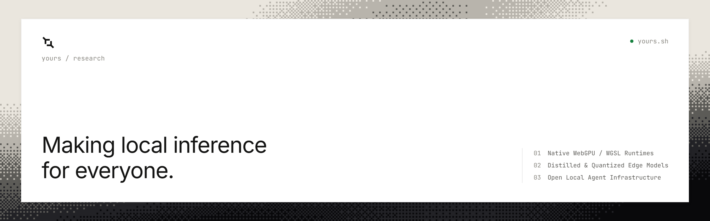

<div align="center">
  <a href="https://yours.sh">
    <picture>
      <source media="(prefers-color-scheme: dark)" srcset="https://raw.githubusercontent.com/yours-research/yours-ui/main/assets/hero-dark.png" />
      <source media="(prefers-color-scheme: light)" srcset="https://raw.githubusercontent.com/yours-research/yours-ui/main/assets/hero-light.png" />
      
    </picture>
  </a>

  <p>
    <a href="https://yours.sh"><strong>yours.sh</strong></a>
    &nbsp;&middot;&nbsp;
    <a href="https://github.com/yours-research"><strong>GitHub Org</strong></a>
    &nbsp;&middot;&nbsp;
    <a href="https://huggingface.co/yours-research"><strong>Hugging Face</strong></a>
    &nbsp;&middot;&nbsp;
    <a href="https://x.com/yoursdotsh"><strong>X (@yoursdotsh)</strong></a>
  </p>

  <p>
    <a href="./LICENSE"></a>
    
    
  </p>
</div>

**`@yours/ui`** is the MIT-licensed React component library, design token system, and 48-icon Aperture SVG kit for **Yours Research** (`Tactile Localism × Rare UI Minimalism`).

Built specifically for local-first Chromium MV3 side panels (`340px–440px`), it pairs **Light Cotton Paper** (`#FAF8F5` / `#F2EFE9` / `#FFFFFF`) and **Dark Anodized Obsidian** (`#09090B` / `#111113` / `#18181B`) recessed-stage surfaces with pure React primitives — **zero runtime dependencies**, **zero Tailwind requirement**, and **zero `dangerouslySetInnerHTML`**.

---

## Architecture Overview

```text
SidePanelShell (outer bezel + recessed stage + focus veil + bottom sheet slot)
  ├── TopNotch (144x36 resting -> 272x52 hover-grow -> 272px drawer + HookSidebarList + NotchOptionRow)
  ├── Stream Region
  │     ├── EmptyState / PromptCapsuleStack / MatrixOrb (idle · thinking · streaming)
  │     ├── StreamingResponse · UserMessageBubble · AssistantMessage · ActionBar
  │     ├── InlineCitationPill · InlineCitationPopover · SourcesDrawer · BranchPicker
  │     ├── ReasoningTrace · ToolStepCard · PermissionApprovalCard (@yours/guard)
  │     ├── ModelDownloadGate (@yours/models) · StatusBadge · VoiceDictationPill
  │     └── 8 Generative UI Primitives (CompareTable · ChecklistCard · MetricStripCard · ...)
  ├── FloatingContextSheet (recessed bottom queue / review tray)
  └── FloatingComposer (auto-grow · ContextCommandPopover · KbdHint · SegmentedControl)
```

---

## Quickstart

```bash
npm install git+https://github.com/yours-research/yours-ui.git
```

Import the stylesheet once in your side-panel entrypoint (`src/sidepanel/main.tsx`):

```tsx
import '@yours/ui/styles';
```

Wire the shell, sculpted hover-grow top notch, and composer cleanly with React state (or `@yours/harness/react` `useYoursChat`):

```tsx
import { useState } from 'react';
import {
  SidePanelShell,
  TopNotch,
  NotchDrawerSearch,
  HookSidebarList,
  FloatingComposer,
  PromptCapsuleStack,
  MatrixOrb,
  UserMessageBubble,
  AssistantMessage,
  ActionBar,
  PermissionApprovalCard,
  LocalDeviceIcon,
} from '@yours/ui';

export function SidePanelApp() {
  const [expandedTab, setExpandedTab] = useState<string | null>(null);
  const [prompt, setPrompt] = useState('');

  return (
    <SidePanelShell
      veilOpen={expandedTab !== null}
      onVeilClick={() => setExpandedTab(null)}
      notch={
        <TopNotch
          expandedId={expandedTab}
          onClose={() => setExpandedTab(null)}
          items={[
            { id: 'new', icon: 'compose', label: 'New', onClick: () => setExpandedTab(null) },
            {
              id: 'threads',
              icon: 'history',
              label: 'Threads',
              onClick: () => setExpandedTab((v) => (v === 'threads' ? null : 'threads')),
            },
            {
              id: 'tabs',
              icon: 'tab-stack',
              label: '1 tab',
              badgeDot: 'green',
              onClick: () => setExpandedTab((v) => (v === 'tabs' ? null : 'tabs')),
            },
            {
              id: 'model',
              icon: 'local-device',
              label: 'Model',
              onClick: () => setExpandedTab((v) => (v === 'model' ? null : 'model')),
            },
          ]}
          drawerContent={
            expandedTab === 'threads' ? (
              <>
                <NotchDrawerSearch value="" onChange={() => {}} placeholder="Search recent threads..." count={2} />
                <HookSidebarList
                  activeId="t1"
                  items={[
                    { id: 't1', title: 'Pro vs. Team pricing', meta: 'Now' },
                    { id: 't2', title: 'Lease renewal summary', meta: '2h' },
                  ]}
                />
              </>
            ) : null
          }
        />
      }
      footer={
        <FloatingComposer
          value={prompt}
          onChange={setPrompt}
          onSubmit={() => {}}
          leftSlot={
            <button type="button" className="yui-chip-btn" onClick={() => setExpandedTab('model')}>
              <LocalDeviceIcon size={12} />
              <span>Pragma-1-4B</span>
            </button>
          }
        />
      }
    >
      <MatrixOrb state="idle" size={28} />
      <PromptCapsuleStack
        items={[
          { id: '1', icon: 'document', label: 'Summarize this page' },
          { id: '2', icon: 'compare', label: 'Compare the options' },
          { id: '3', icon: 'compose', label: 'Draft a reply' },
        ]}
        onSelect={(item) => setPrompt(item.prompt ?? item.label)}
      />
    </SidePanelShell>
  );
}
```

---

## Subpath Exports & Inventory

| Subpath | Contents |
| :--- | :--- |
| `@yours/ui` | Complete root barrel exporting icons, layout, chat components, and GenUI primitives. |
| `@yours/ui/icons` | `ApertureIcon`, 48 named `*Icon` components, `APERTURE_ICON_NAMES`, `MatrixOrb`, `NotchEar`, `YoursMark`. |
| `@yours/ui/layout` | `SidePanelShell` (with `sheet` tray slot), `TopNotch` (144x36 -> 272x52 hover-grow & click drawer), `HookSidebarList`, `NotchDrawerSearch`, `NotchOptionRow`, `NotchStatusPill`, `GreenLed`. |
| `@yours/ui/components` | `FloatingComposer`, `FloatingContextSheet`, `ContextCommandPopover`, `KbdHint`, `SegmentedControl`, `QuotedContextBanner`, `VoiceDictationPill`, `AttachmentStrip`, `AttachmentDropzone`, `EmptyState`, `StatusBadge`, `PromptCapsuleStack`, `SuggestionChipRow`, `ScrollToBottomButton`, `UserMessageBubble`, `AssistantMessage`, `StreamingResponse`, `CodeBlock`, `ActionBar`, `BranchPicker`, `FollowUpSuggestions`, `ReasoningTrace`, `ToolStepCard`, `PermissionApprovalCard`, `SourcesDrawer`, `InlineCitationPill`, `InlineCitationPopover`, `ThreadHistoryDrawer`, `ErrorRecoveryBanner`, `MessageSkeleton`, `ToastPill`, `ModelDownloadGate`. |
| `@yours/ui/genui` | `CompareTable`, `ChecklistCard`, `PageBriefCard`, `DraftCard`, `EntitySummaryCard`, `ChoicePromptCard`, `MetricStripCard`, `PageActionCard`. |
| `@yours/ui/styles` | Full Cotton Paper + Anodized Obsidian CSS variables (`tokens.css`) and scoped `.yui-*` classes (`components.css`). |

---

## Brand & Extension Icons Included

- `src/icons/*.svg` + [`icons.yaml`](./icons.yaml): 48 source-controlled 24x24 Aperture SVGs (`1.75` stroke, `45°` container chamfers).
- `assets/brand/extension/`: Chromium MV3 extension icons (`16`, `32`, `48`, `128`, `512`, `1024`, `.svg`).
- `assets/brand/regular/` & `assets/icon.svg`: Monochrome light/dark monogram assets.

---

## Sibling Ecosystem

| Repository | Package | Focus | License |
| :--- | :--- | :--- | :--- |
| [`yours-browser-extension`](https://github.com/yours-research/yours-browser-extension) | App | Chromium MV3 local AI side panel + Rust WASM / WGSL runtime | Apache-2.0 |
| [`yours-ui`](https://github.com/yours-research/yours-ui) | `@yours/ui` | Design kit, 48 Aperture icons, top notch, chat & GenUI components | **MIT** |
| [`yours-harness`](https://github.com/yours-research/yours-harness) | `@yours/harness` | Turn state machine, KV-preserving compaction, `useYoursChat` React hook | Apache-2.0 |
| [`yours-tools`](https://github.com/yours-research/yours-tools) | `@yours/tools` | Canonical Schema v1.1, AOM extractor, sandbox & dual web/MV3 adapters | Apache-2.0 |
| [`yours-guard`](https://github.com/yours-research/yours-guard) | `@yours/guard` | IDPI HTML sanitizer, spotlighting delimiters & Lethal Trifecta breaker | Apache-2.0 |
| [`yours-memory`](https://github.com/yours-research/yours-memory) | `@yours/memory` | SQLite-WASM FTS5 + HNSW local memory engine | Apache-2.0 |
| [`yours-models`](https://github.com/yours-research/yours-models) | `@yours/models` | Verified parallel OPFS model downloader & WebGPU prober | Apache-2.0 |
| [`yours-voice`](https://github.com/yours-research/yours-voice) | `@yours/voice` | Local VAD, STT/TTS pipeline with instant barge-in | Apache-2.0 |
| [`yours-evals`](https://github.com/yours-research/yours-evals) | `@yours/evals` | End-to-end local harness & safety regression suite | Apache-2.0 |

<br />

<div align="center">
  <sub><code>yours / research</code> &nbsp;&middot;&nbsp; Making local inference for everyone.</sub>
</div>
